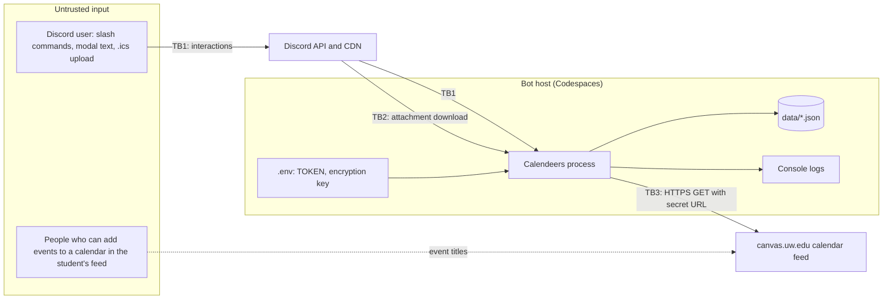

# Calendeers — Code Analysis and Hardening Report

**Introduction**

Calendeers is a Discord bot designed to help students manage their academic schedules through Canvas and Register.UW integration. This report evaluates the bot's code quality, maintainability, complexity, architecture, and automated testing. The goal is to identify technical weaknesses, document existing limitations, and recommend improvements that make Calendeers more reliable and easier to maintain.

---

## 1. Technical Debt and Code Smells

**File analyzed:** `src/events/interactionCreate.js`

**Finding 1: Large Event Handler**
The `execute()` function handles multiple Discord commands, select menu interactions, and modal submissions. This makes the function harder to read, maintain, and test as new features are added.

**Recommendation:** Split command handlers into smaller functions or separate modules, each responsible for one feature.

**Finding 2: Duplicated Code**
The `/schedule` and `/upcoming-assignments` commands contain similar code for retrieving and formatting calendar events, including dates, titles, and locations. Maintaining duplicate logic can lead to inconsistent behavior.

**Recommendation:** Extract shared calendar-event formatting into a reusable helper function.

**Finding 3: Multiple Responsibilities**
The interaction handler manages Discord responses, input validation, calendar data retrieval, schedule storage, and error handling in one file. This increases maintenance effort and makes independent testing more difficult.

**Recommendation:** Keep interaction handling separate from business logic and use dedicated services or helper functions.

**File analyzed:** `src/services/canvasFeed.js`

**Finding 4: Same output out of a condition**
The logic of tomorrowOnly function in canvasFeed returns the same result regardless of the condition. " return tomorrowOnly ? sorted : sorted;" 

**Recommendation:** Double check the function's logic and repair it if problems found.

**Summary:** These are maintainability concerns rather than confirmed runtime bugs. Refactoring would improve readability, testability, and future feature development.

**File analyzed:** `src/events/interactionCreate.js`

**Finding 5: Parser can't differentiate between assignments and classes**
The /upcoming-assignments function cannot properly differentiate between assignments and upcoming classes. It only looks for upcoming events and displays all of them without sorting them properly.

**Recommendation:** Add a the ability for our bot to sort between classes and assignments when parsing calendar events.

**Summary:** These are functional issues, and would benefit the end user if fixed. They do not affect the ability for our bot to run, but will affect user experience if not fixed. An issue has been made for this problem.

**Files analyzed:** whole repository (static analysis with ESLint), `src/services/canvasFeed.js`, `src/services/classSchedule.js`, `src/events/*.js`, project configuration

**Method:** I ran ESLint with its recommended rule set over `src/` and `tests/`, then read through the services and event handlers looking for duplicated logic, dead code, and shortcuts left from the bot template. I tested each suspected bug with a script before writing it down.

**Finding 6: ESLint reported 23 errors**
Running ESLint before any configuration gave 23 errors (`static-analysis/eslint-output-before.txt`, `eslint-screenshot-before.png`). 22 were `no-undef` because ESLint did not know the Node.js (`process`, `Buffer`) and Mocha (`describe`, `it`) globals. The remaining one was real dead code: `getWelcomeMessageWithMeme()` in `guildMemberAdd.js`, left over from the meme-bot template. `getMeme()` was dead too, because that function was its only caller.

Two of the `no-undef` errors point at a deeper issue. `src/` is written as ES modules, but `app.js` uses `__dirname` and `loadEvents.js` uses `require()`, which only exist in CommonJS. The bot only runs because `npm start` first converts everything to CommonJS with esbuild. Declaring the Node globals makes ESLint pass, but it also hides this.

**Resolved in this PR (closes issues #30 and #31):** added `eslint.config.mjs` with Node and Mocha globals and a `npm run lint` script, and removed the unused meme code (`getWelcomeMessageWithMeme()` and `getMeme()`, plus `MEME_URL` from `.env-sample` and the class diagram). In test files, unused function parameters are allowed, because the Discord mocks copy real method signatures. ESLint now reports 0 problems (`static-analysis/eslint-output-after.txt`).

**Recommendation:** Replace `require()` and `__dirname` with ES-module equivalents (`import()`, `import.meta.url`), and run `npm run lint` in CI.

**Finding 7: `/missing` finds no assignments in a real Canvas feed**
`/missing` worked with the test feed but reported "No missing assignments" for a real UW Canvas feed. There were two causes in `isAssignmentEvent()` and `getCanvasURL()`:
- A real feed does not put `Assignment:` in front of assignment titles. The only reliable marker is the UID, `event-assignment-<id>`.
- A real feed writes the link as `URL;VALUE=URI:...`. node-ical turns that into an object (`{ params, val }`), so `String(event.url)` becomes `"[object Object]"`, and the URL check never matches.

**Resolved in this PR:** assignments are now detected by UID as well, the URL object is unwrapped, and the calendar-page link (`calendar?include_contexts=course_<c>#assignment_<a>`) is turned into a direct `https://canvas.uw.edu/courses/<c>/assignments/<a>` link. Links to any other host are still dropped. A link with a port or a username is now rejected too, matching `validateFeedURL()`. Seven regression tests use the real feed format (`tests/missingRealFeed.spec.js`). The first four were written before the fix, and three of them failed on the old code.

**Finding 8: Duplicated feed and assignment logic in `canvasFeed.js`**
`getUpcomingEvents()` and `fetchMissingAssignmentsCalendar()` contain the same download and validation code. The rule for "is this an assignment" is also written twice: inline in `getUpcomingEvents()`, and in `isAssignmentEvent()`. The second copy was added with `/missing` to avoid changing shared code. Finding 7 shows the cost: the bug existed in both copies, and the fix above only covers `/missing`. `getUpcomingEvents({ excludeAssignments: true })` still cannot recognize assignments in a real feed, which is part of issue #36.

**Recommendation:** Keep one `fetchCalendar()` and one `isAssignmentEvent()` and use them from both functions.

**Finding 9: Two different `safeText()` functions**
`interactionCreate.js` and `classSchedule.js` each define `safeText()` with different rules: only the second one removes `@`. Neither removes `[`, `]`, `(` and `)`, which lets Discord masked links through (see Threat T3 in Section 5).

**Recommendation:** Move one sanitizer into a shared helper, test it once, and use it for every piece of text that comes from a calendar.

**Finding 10: Long `/schedule` and `/upcoming-assignments` replies fail**
Both commands add every event to a single message with no length limit. With 15 events in the window, the replies were 2,169 and 2,182 characters long, and Discord rejects messages over 2,000. The `catch` block then tells the user to "check your feed connection", which sends them looking for the wrong problem. `/missing` and `/classes` already cut their output to fit.

**Recommendation:** Cap the list like `formatMissingAssignments()` does ("…and N more"), and share that formatter between the two commands (this also covers Finding 2).

**Finding 11: Leftovers from the template and out-of-date help**
- `!help` lists only `!help` and an "Assignment Reminder" feature that is not merged (PR #38 is still open). None of the seven slash commands are mentioned.
- `package.json` is still named `memebot_discord`, with the description "demo project for teaching how to build a discord bot".
- `.github/workflows/build-and-deploy.yml` pushes an image called `memebot:latest` from a `release` branch, using old action versions (`checkout@v2`, `docker/*@v1`/`@v2`).
- `Dockerfile` uses `node:18`, which reached end of life in April 2025.
- `ready.js` logs "Registered /ping" after registering all seven commands.

**Recommendation:** Update `!help` from the registered command list, and rename or remove the template pieces.

**Finding 12: Most tests do not run automatically, and coverage fails on Windows**
CI (`ci.yml`) only runs `npm run test:smoke`. The 52 unit tests in `tests/*.spec.js`, including the `/missing` regression tests, and ESLint only run when someone remembers to run them by hand. Also, `npm run test:coverage` fails on Windows with `spawn npx ENOENT`, because `scripts/coverage.mjs` starts `npx` without a shell.

**Recommendation:** Add an `npm test` step to `ci.yml`, and a `npm run lint` step on one Node version of 22 or later (ESLint 10 does not support the Node 18.16.0 entry in the CI matrix). Spawn with `shell: true` (or call c8 through Node) in `coverage.mjs`.
**Finding 13: `npm start` no longer starts the bot**
Since PR #44 (merged Nov 13), `package.json` has `"type": "module"`. The build script still compiles `src/` to CommonJS in `build/`, so Node now loads `build/app.js` as an ES module and stops at the first line: `ReferenceError: require is not defined in ES module scope`. The same happens to anyone who restarts the shared bot from `main`.

Telling Node that `build/` is CommonJS is not enough on its own. With `"type": "module"`, esbuild also changes how it compiles the re-exports in `helpers/index.js`, so `loadEvents` becomes an object (`{ default }`) and `app.js` would fail next with "loadEvents is not a function". Removing the line fixes both problems. I checked this locally: all unit, smoke and fuzz tests, ESLint and coverage still pass, and the built bot loads every event handler and reaches `client.login()` (stubbed, so it did not connect). The fuzzer then prints a module-type warning on Node 24, and would not run at all on Node 18.

CI did not catch this because it only runs the smoke tests through esbuild-runner. It never runs `npm run build` or loads the built bot.

**Recommendation:** Remove `"type": "module"` and rename `src/fuzz/fuzz-test.js` to `.mjs`, or move the whole project to native ES modules and drop the CommonJS build (see Finding 6). Add a CI step that builds the bot and loads `build/app.js` with `login()` stubbed.

## 2. Cyclomatic Complexity

**File analyzed:** `src/events/interactionCreate.js`

**Method:** I manually analyzed the `execute()` function by counting decision points, including if statements, catch clauses, logical operators, ternary expressions, nullish coalescing, and optional chaining. Branches inside nested callback functions were counted separately.

**Result:** The estimated cyclomatic complexity of `execute()` is 37 under these counting rules.

**Finding:** The function handles several Discord commands, select menu interactions, and modal submissions. The numerous conditional branches increase its complexity and make testing and maintenance more difficult.

**Recommendation:** Refactor `execute()` into smaller command handlers. This would reduce the complexity of individual functions and make unit testing easier.

**Conclusion:** The current event handler has high structural complexity and would benefit from refactoring.

## 3. Cohesion and Coupling

**File analyzed:** `src/events/interactionCreate.js`

**Method:** I examined the responsibilities of the event handler and counted its direct dependencies on service modules.

**Coupling Analysis:**
The file imports functions from three service modules:
- `calendarStore`: 9 imported functions
- `canvasFeed`: 3 imported functions
- `classSchedule`: 4 imported functions

In total, the event handler imports 16 functions from 3 internal service modules.

This creates multiple direct dependencies. Changes to service interfaces may require updates to the event handler.

**Cohesion Analysis:**
The `execute()` function handles seven slash commands, a select menu interaction, and a modal submission. These operations involve calendar management, assignment tracking, class schedules, and Discord responses.

Although these features are related to the bot, combining them into one large function reduces functional cohesion and makes independent testing more difficult.

**Recommendation:**
Separate the interaction handler into smaller command-specific modules. Keep calendar storage, Canvas integration, and class schedule processing in dedicated services.

**Conclusion:**
The current design has several direct service dependencies and mixes multiple responsibilities within one event handler. Refactoring could improve cohesion, reduce unnecessary coupling, and simplify maintenance.

**Measurement Note:** Dependency counts are based on static imports. Cohesion was assessed qualitatively rather than using a numerical cohesion metric.

## 4. Test Coverage Analysis

**Objective:** Measure and improve test coverage across the Calendeers codebase, with focus on critical calendar and schedule-processing functionality.

**Methodology:**
- **Testing Framework:** Mocha with Chai assertions for unit testing
- **Coverage Tool:** c8, which uses V8's native code coverage capabilities and generates Istanbul-compatible reports
- **Scope:** All 11 JavaScript source files under `src/`
- **Key Issue Addressed:** Resolved ES module import compatibility issues and configured c8 to collect accurate coverage data
- **Baseline:** 8 existing unit tests in `tests/missingAssignments.spec.js`
- **Improvement:** Added 27 new comprehensive unit tests targeting core service functions

**Coverage Results:**

| Metric | Before (8 Tests) | After (35 Tests) | Improvement |
|--------|------------------|------------------|-------------|
| **Statement Coverage** | 19.60% | 27.82% | +8.22 pp |
| **Branch Coverage** | 79.31% | 85.98% | +6.67 pp |
| **Function Coverage** | 11.62% | 20.93% | +9.31 pp |
| **Line Coverage** | 19.60% | 27.82% | +8.22 pp |
| **Passing Tests** | 8 | 35 | +27 tests |

**File-Level Improvements:**
- **`canvasFeed.js`:** 35.81% → 45.11% (+9.30 pp, +26% relative)
- **`classSchedule.js`:** 16.29% → 60.67% (+44.38 pp, +272% relative) — significant improvement through comprehensive schedule parsing tests
- **`calendarStore.js`:** 27.27% → 27.27% — no new tests added for this module

**Coverage Gaps & Untested Modules:**
- **Discord Event Handlers** (`guildMemberAdd.js`, `messageCreate.js`, `ready.js`): 0% coverage — could be tested using mocked Discord.js interactions
- **Bot Initialization** (`app.js`): 0% coverage — requires bot startup and configuration context
- **Helper Modules** (`index.js`, `loadEvents.js`, `loadFiles.js`): 0% coverage — require event loader and context setup

These gaps highlight opportunities for further testing. Discord event handlers and helper modules could be tested using mocks, while integration tests would help verify bot initialization and interactions between components.

**Key Findings — Test Coverage:**
- ES module import resolution was blocking coverage measurement entirely
- The original tests did not directly exercise `parseClassSchedule()`
- Statement coverage across the entire codebase improved by approximately 42% relative to baseline, while service-layer coverage increased from 27.04% to 45.90%
- Reported branch coverage reached 85.98%, although significant portions of the codebase remain untested

## 5. Threat Model

**Objective:** Find out what a malicious user, a bad input, or an ordinary mistake could do to Calendeers and the students who use it, check which of those risks are real, and rank what should be fixed first.

**Method:**
- Listed the assets the bot holds and drew the trust boundaries the data crosses.
- Went through each boundary with the STRIDE categories (Spoofing, Tampering, Repudiation, Information disclosure, Denial of service, Elevation of privilege).
- Tested every threat that could be run locally with a script. The script used mocked Discord interactions, a local HTTP server serving test `.ics` files, and a throwaway encryption key, so no real Canvas data or Discord account was involved. Threats that could not be run are marked "code review".
- Checked dependencies with `npm audit` and searched the git history for committed secrets.

### Assets

| Asset | Where it lives | Why it matters |
|---|---|---|
| Canvas calendar feed URL | `data/calendar-links.json`, AES-256-GCM encrypted | The URL contains a secret token. Anyone who has it can read the student's whole Canvas calendar without logging in. |
| Register.UW class schedule | `data/class-schedules.json`, encrypted | Class times and rooms show where a student is during the week. |
| Completed-assignment IDs | `data/completed-assignments.json`, plain JSON | Canvas assignment IDs only; low value. |
| `TOKEN`, `CALENDAR_ENCRYPTION_KEY` | `.env` (git-ignored) | The token gives full control of the bot; the key decrypts every stored feed URL and schedule. |
| Bot availability | the running Node.js process | One process serves every user and every server. |

### Data flow and trust boundaries

- **TB1:** Everything in an interaction (command options, modal text, select-menu values) comes from the user.
- **TB2:** The uploaded `.ics` file is fully controlled by the user.
- **TB3:** The feed is fetched from Canvas, but event titles in it are written by other people: instructors, and in courses that use Canvas groups, other group members.

### Threats

| ID | STRIDE | Threat | How it was checked | Status | Risk |
|---|---|---|---|---|---|
| T1 | Denial of service | **Any uncaught error in an event handler crashes the whole bot.** The discord.js client is created with `captureRejections: true`, so a rejected handler promise is re-emitted as an `error` event. Calendeers registers no `error` listener, so Node throws and the process exits. Two easy triggers: (a) a member joins a server that has no channel named `CHANNEL_NAME` (`guildMemberAdd.js:13`, `channel` is `undefined`); (b) a data file is unreadable or corrupted and someone runs `/disconnect`, which has no `try/catch`. | Reproduced: both triggers, and a bare discord.js `Client` with a throwing listener, ended with exit code 1. | Open | **High** |
| T2 | Information disclosure | **The secret feed URL is written to the logs.** Every `catch` in `interactionCreate.js` calls `console.error(..., error)`. For an Axios error, that prints `config.url`, the full feed URL with its token. Anyone who can read the host's console, such as Codespace collaborators or a future hosting provider's log viewer, can then read that student's calendar. | Reproduced: a failed `/schedule` printed `url: '.../user_SECRETTOKEN123.ics'`. | Open | **Medium** |
| T3 | Spoofing | **Masked links in event titles.** `safeText()` removes `` ` * _ ~ \| < > `` but not `[ ] ( )`, so a title like `[Resubmit on Canvas](https://phish.example)` shows up as a clickable link with fake text in `/schedule`, `/upcoming-assignments` and `/missing`. The title can be written by anyone who adds events to a calendar in the student's feed (TB3). | Reproduced: `formatMissingAssignments()` kept the masked link. Who can add group events was checked against Canvas behavior, not with a live account. | Open | Medium-Low |
| T4 | Denial of service | **Long replies fail** (Finding 10). This one does not need an attacker: a normal week with about 15 events breaks `/schedule` and `/upcoming-assignments`, and the error message names the wrong cause. | Reproduced: 2,169 and 2,182 characters, over Discord's 2,000 limit. | Open | Medium |
| T5 | Denial of service | **Command spam.** There is no per-user cooldown. Each `/schedule`, `/upcoming-assignments` and `/missing` downloads up to 1 MB from Canvas, and `/connect` downloads two files. Discord's own rate limits only partly cover this. | Code review | Open | Low |
| T6 | Denial of service | **Malicious recurrence rules in an `.ics` file** (for example `RRULE:FREQ=SECONDLY`). | Reproduced: node-ical stops after 10,000 occurrences and throws (219 ms), and the command's `catch` handles it. `parseClassSchedule()` never expands rules (2 ms). | Mitigated by node-ical | Low |
| T7 | Tampering / SSRF | **Making the bot fetch an arbitrary URL.** `validateFeedURL()` only accepts `https://canvas.uw.edu/feeds/calendars/user_*.ics` with no port, credentials, query or fragment. Requests use `maxRedirects: 0` and a size cap. Uploads must come from Discord's CDN hosts, end in `.ics`, and be at most 512 KB. | Fuzzer (Section 6), unit tests (Section 7) | Mitigated | Low |
| T8 | Information disclosure | **Stored data read from disk.** Feed URLs and schedules are encrypted with AES-256-GCM using a random IV per record. Files are created with mode `0600` in a `0700` directory. The key has never been committed (`git log -S` only finds the placeholder in `.env-sample`). The remaining risk: the key sits on the same host as the data, so a full host compromise exposes both, and there is no way to rotate the key. | Code review, git history | Mitigated | Low |
| T9 | Elevation of privilege | **Reading another user's data.** Every record is keyed by `interaction.user.id`, which comes from Discord. No command takes another user's ID, and replies are ephemeral. Separately, the bot asks for the privileged `MessageContent` intent only to answer `!help`, which is more access than it needs. | Code review | Mitigated (least-privilege gap) | Low |
| T10 | Repudiation | **No record of actions.** The bot logs only errors, so there is no record of who connected or disconnected a calendar, or when. | Code review | Accepted for a class project | Low |
| T11 | Tampering (supply chain) | **Vulnerable dependencies.** `npm audit --omit=dev` reports 0 vulnerabilities. The full audit reports 7 (6 moderate, 1 high) in test tooling only (`glob`, `minimatch` and `serialize-javascript` under mocha and c8). These are not installed in the production Docker image (`npm ci --omit=dev`). | `npm audit` | Mitigated | Low |

### Priorities

1. **T1, crash on any handler error.** One member joining one server takes the bot offline everywhere until someone restarts it by hand. The fix is small: register a `client.on("error", ...)` handler, wrap every handler in `try/catch`, and check that the welcome channel exists before sending.
2. **T2, feed URL in logs.** Log `error.message` or `error.code` instead of the whole error object, and never log a request URL.
3. **T4, long replies.** This affects ordinary users every week. Fix it together with Finding 2 through a shared, length-limited formatter.
4. **T3, masked links.** Escape `[ ] ( )` in one shared `safeText()` (Finding 9).
5. **T5 and T9.** Add a short per-user cooldown on commands that fetch from Canvas, and drop the `MessageContent` intent by turning `!help` into a `/help` slash command.

**Key Findings: Threat Model:** The input boundaries are the strongest part of the bot: URL validation, upload checks, size limits, and encryption at rest all held up when tested. The weak spots are on the operations side. Unhandled errors take the whole process down, and the most sensitive value the bot holds, the feed URL, can end up in plain text in the logs. Neither problem needs a skilled attacker: T1 can be triggered just by joining a server.

**Testing Gaps & Future Recommendations:**
- All tests used mocked Discord interactions and a local feed server. T1 and T4 should be confirmed against the live Discord API with a test bot.
- Whether students can add events to a calendar that appears in a classmate's feed (T3) should be confirmed with a real Canvas group.
- After the T1 fix, add regression tests that run the event handlers with a missing channel and a corrupted data file.

## 6. Fuzzer

**Objective:** Generate random links to break the canvasFeed.js to ensure no malicious links or false links being used.

**Implementation:** Created src/fuzz/fuzz-test.js using fast-check library. Fuzzer generates 1000 random links each for valid canvas calendar, untrusted hosts, and URL query string and fragments.

**Result:** All random links are successfully filtered. Valid canvas URLs are processed, and the other links are rejected.

**Testing Gaps & Future Recommendations:**
- Fuzzer test is recommended to be implemented across this project to reduce the risk of mis-use and to prevent bugs.
- Limited URL Variations; Only 3 types of links are generated for this test. More variations can be generated to further test the filtering function.
- The fuzzer only tests validateFeedURL(). It does not test whether canvasFeed.js can safely handle corrupted, incomplete, or malicious .ics calendar data.

## 7. Unit Testing

**Objective:** Implement comprehensive unit tests for untested or undertested functionality.

**Implementation:** 27 unit tests added to `tests/validationSchedule.spec.js`

**validateFeedURL() — 12 Tests:**
- Valid Canvas calendar URLs (webcal:// and https:// protocols)
- Whitespace trimming and normalization
- Rejection of invalid hostnames and wrong domains
- Rejection of invalid protocols and non-HTTPS schemes
- Port number validation
- Credential/authentication rejection
- Query parameter validation
- URL fragment rejection
- Invalid URL path formats
- User ID validation
- Missing `.ics` extension detection
- Case-insensitive protocol handling

**parseClassSchedule() — 15 Tests:**
- Valid Register.UW `.ics` schedule file parsing
- Multi-course schedule extraction
- Course name parsing
- Recurring event meeting day extraction (RRULE BYDAY)
- Meeting time calculations with UTC-to-America/Los_Angeles timezone conversion
- Meeting location extraction
- Duplicate meeting detection and rejection
- Invalid `.ics` format rejection
- Plain text (non-calendar) rejection
- Error handling when no meetings found
- All-day event filtering (VALUE=DATE)
- Courses with no meetings handling
- Chronological ordering by day and start time
- Whitespace normalization in course names
- Invalid input type validation

**Test Results:**
- **All 35 tests passing** (61ms execution time)
- **0 failures, 0 regressions** — all original 8 tests remain passing
- No application functionality modified
- Synthetic test data used (no real Canvas tokens or personal information)

**Impact on Reliability:**
- The new tests help detect regressions in Canvas URL validation and class schedule parsing, including malformed inputs, recurring events, and edge cases
- Timezone conversion logic is now verified against expected UTC→Pacific time calculations
- Security-relevant URL validation is explicitly tested with adversarial inputs
- Automated test execution helps catch potential issues when code changes occur

**Key Findings — Unit Testing:**

Overall, the 27 new unit tests improve confidence in Calendeers' Canvas URL validation and class schedule parsing. They also help detect potential regressions involving malformed input, recurring events, and timezone conversions. However, additional tests are needed for Discord interactions, calendar storage, and external API failures.

**Testing Gaps & Future Recommendations:**
- Event handlers require Discord.js mock infrastructure (beyond current scope)
- Integration testing would verify end-to-end calendar workflows
- Fuzzing could reveal additional edge cases in calendar parsing
- Mock-based tests for `calendarStore.js` file operations would improve storage-layer coverage
- Mock-based tests for API calls in `canvasFeed.js` would reach currently uncovered network paths

### Additional Unit Tests: Real Canvas Feeds and Schedule Inputs

**Objective:** Cover code that the tests above do not reach: `/missing` with the format a real Canvas feed uses, the checks on uploaded schedule files, and the `/classes` formatter.

**Implementation:** 17 unit tests in two new files.

`tests/missingRealFeed.spec.js`, `findMissingAssignments()` with a real-format feed (7 tests):
- Detects an assignment from its `event-assignment-<id>` UID when the title has no `Assignment:` prefix.
- Does not treat a regular `event-calendar-event-<id>` as an assignment.
- Builds a direct `courses/<c>/assignments/<a>` link from the `URL;VALUE=URI` object.
- Drops a link whose host only looks like Canvas (`canvas.uw.edu.example.com`).
- Drops a Canvas link that has a port or a username.
- Keeps the calendar-page link when it cannot be turned into an assignment link (more than one course context).
- Still detects assignments by `Assignment:` title prefix or `/quizzes/` URL when the UID is generic. Before this test, every fixture had an `event-assignment-` UID, so those two checks were untested.

`tests/classScheduleInputs.spec.js`, `downloadScheduleFile()` input checks (5 tests). Every case is rejected before any network request, and `axios.get` is replaced with a function that fails the test if a request is ever made:
- Rejects a non-`.ics` file.
- Rejects a host outside Discord's CDN.
- Rejects a look-alike host (`cdn.discordapp.com.evil.example.com`).
- Rejects a file over 512 KB.
- Rejects a malformed attachment URL.

`tests/classScheduleInputs.spec.js`, `formatClassSchedule()` (5 tests):
- 12-hour times, including 12:00 AM and 12:00 PM.
- Joined meeting days and the location.
- "1 class" versus "2 classes".
- Removes Markdown and mention characters (`**`, `@everyone`, `<@id>`, backticks).
- Stays under Discord's 2,000-character limit for long schedules.

**Checking that the tests can fail:**
- The first four real-feed tests were written before the `/missing` fix (Section 1, Finding 7); three of them failed on the old code.
- For the schedule tests, I temporarily broke the code under test: allowed any host that starts with a CDN name, doubled the size limit, and stopped removing `@`. The matching tests failed each time, and the code was then restored.

**Results:** All 52 unit tests and all 25 smoke tests pass. Measured with c8 over `src/` (excluding the fuzzer), before and after this change:

| Metric | Before | After |
|---|---|---|
| Statements | 28.53% | 34.30% |
| Functions | 20.93% | 31.81% |
| `classSchedule.js` statements | 60.67% | 88.76% |
| `canvasFeed.js` statements | 45.11% | 51.23% |

**Key Findings: Additional Unit Tests:** The `/missing` bug got through review and testing because every test feed was written by hand to match what we assumed Canvas sends. Tests built from the real feed format would have caught it before release.

**Testing Gaps & Future Recommendations:**
- `getUpcomingEvents()` and `getMissingAssignments()` still have no tests for their network path. Serving fixtures from a local HTTP server, as the threat-model script did, would cover them without calling Canvas.
- Once the T1 fix is in, add tests for handler error paths (missing welcome channel, corrupted data file).

## 8. Smoke Testing

**Objective:** Implement automated smoke tests to verify that the core functionality of Calendeers continues to work as expected, particularly calendar processing and Discord command interactions.

**Implementation:** Created two smoke-test files under `tests/smoke/` using the existing Mocha and Chai testing frameworks.

**calendar.spec.js:**

 - Tests Canvas calendar URL validation.
 - Tests Register.UW .ics calendar parsing.
 - Verifies course and event information extraction.
 - Tests recurring class schedules.
 - Verifies calendar data formatting.
 - Tests handling of invalid calendar data.
 - Tests overdue assignment identification.

**commands.spec.js:**

 - Tests all seven Discord slash commands.
 - Verifies expected command responses.
 - Tests command input validation and error handling.
 - Tests behavior when users have not connected their calendars.
 - Tests `/connect` modal creation and submission.
 - Tests `/missing` assignment completion menu interactions.

**Testing Methodology:**

 - Mocked Discord interactions to simulate user commands without requiring a live Discord connection.
 - Synthetic Discord user IDs used to isolate test data.
 - Existing application functions tested without requiring significant modifications to the bot's implementation.
 - Tests can be executed independently using `npm run test:smoke`.

**Result:** A dedicated smoke-testing suite was established to verify the bot's primary calendar-processing and Discord interaction functionality. This provides an additional layer of automated testing beyond the existing unit tests.

**Impact on Reliability:**

 - Helps identify regressions in calendar parsing and command handling.
 - Verifies that important Discord interactions continue to function correctly.
 - Reduces the need for repetitive manual testing.
 - Provides a foundation for expanding automated testing as new features are introduced.

**Key Findings — Smoke Testing:** The smoke tests provide coverage of the bot's primary user-facing functionality without requiring a live Discord environment. Using mocked interactions also allows tests to execute independently of Discord authentication and external services.

**Testing Gaps & Future Recommendations:**

 - Additional storage and encryption tests could improve confidence in persistent user data handling.
 - Integration tests could verify complete calendar connection workflows.
 - Live Discord testing using a dedicated test bot could verify interactions with the Discord API.
 - Additional edge-case testing could improve coverage of malformed calendar data and unexpected user inputs.

## 9. Continuous Integration and Continuous Deployment

**Objective:** Implement an automated Continuous Integration (CI) pipeline to execute smoke tests whenever changes are pushed to the repository or pull requests are created. Establish a foundation for future Continuous Deployment (CD).

**Implementation:** Created `.github/workflows/ci.yml` using GitHub Actions to automate the testing process.

**Workflow Configuration:**

 - Triggers automatically when code is pushed to the main or develop branches.
 - Triggers automatically when pull requests target either branch.
 - Checks out the repository using GitHub Actions.
 - Installs the required Node.js version and project dependencies.
 - Uses npm ci to install dependencies consistently.
 - Executes the smoke-testing suite using `npm run test:smoke`.

**Node.js Compatibility Testing:**

Configured a Node.js version matrix to execute the smoke tests across multiple runtime versions:

 - Node.js 18.16.0 — Original development environment.
 - Node.js 22 — Newer LTS version.
 - Node.js 24 — Newer LTS version.
 - Node.js 26 — Current LTS version.

Separate GitHub Actions jobs are created for each Node.js version. This allows compatibility issues to be identified independently and helps determine which Node.js version should be used for future development and deployment.

**Result:** An automated CI workflow was established using GitHub Actions. Smoke tests can now be executed automatically when changes are pushed or pull requests are opened, providing developers with feedback about potential regressions.

**Impact on Development Workflow:**

 - Reduces reliance on manually executing smoke tests.
 - Provides consistent automated testing across multiple Node.js versions.
 - Helps identify compatibility issues before changes are merged.
 - Improves confidence when introducing new features or modifying existing functionality.
 - Establishes a foundation for requiring successful CI checks before merging pull requests.

**Continuous Deployment (Future Implementation):**

Continuous Deployment has not yet been implemented because Calendeers currently runs within GitHub Codespaces for development and testing rather than a permanent hosting environment.

Once a hosting provider has been selected, CD could be introduced through GitHub Actions.

Potential future functionality includes:

 - Automatically deploying changes after successful CI checks.
 - Securely managing deployment credentials using GitHub Secrets.
 - Automatically restarting the bot following deployment.
 - Verifying that the deployed bot successfully starts and connects to Discord.

**Key Findings — CI/CD:**

The implementation of GitHub Actions provides an automated and repeatable testing process that improves the reliability of the development workflow. The Node.js version matrix also provides a way to evaluate runtime compatibility before selecting a version for future deployment.

Although Continuous Deployment remains future work, the existing CI pipeline provides the foundation needed to introduce automated deployment once a permanent hosting environment is established.

**Testing Gaps & Future Recommendations:**

 - Review CI results to determine the most appropriate supported Node.js version for Calendeers.
 - Configure GitHub branch protection to require successful CI checks before merging pull requests.
 - Introduce Continuous Deployment once a permanent hosting environment is available.
 - Add automated deployment health checks to verify successful bot restarts and Discord connections.
---
